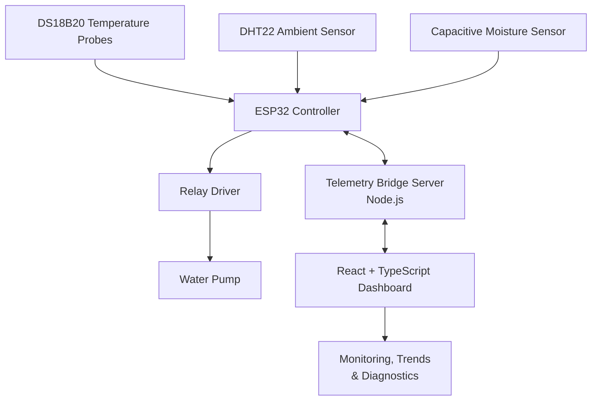

# 🏗️ SMART CURE
### Smart Concrete Curing Monitoring & Automated Water Dispensing System

<p align="center">
  <strong>Intelligent monitoring. Data-driven curing. Controlled water delivery.</strong>
</p>

<p align="center">
  
  
  
  
</p>

SMART CURE is an embedded systems and web-monitoring project designed to monitor concrete curing conditions and support controlled water irrigation. It combines sensor-based measurements, ESP32-based data acquisition, a telemetry bridge server, and a web dashboard to make curing conditions easier to observe and manage.

The project aims to support more consistent curing practices through real-time monitoring, historical data analysis, and moisture-based irrigation logic.

---

## 📑 Table of Contents

- [Overview](#-overview)
- [Key Features](#-key-features)
- [System Architecture](#-system-architecture)
- [Hardware Components](#-hardware-components)
- [Technology Stack](#-technology-stack)
- [Repository Structure](#-repository-structure)
- [Getting Started](#-getting-started)
- [Hardware Integration](#-hardware-integration)
- [Data Structures and Algorithms](#-data-structures-and-algorithms)
- [Configuration and Security](#-configuration-and-security)
- [Current Development Status](#-current-development-status)
- [Future Enhancements](#-future-enhancements)
- [Documentation](#-documentation)
- [Contributing](#-contributing)
- [License](#-license)

## 🎯 Overview

Concrete curing is essential for achieving the intended strength, durability, and performance of concrete. Inadequate moisture maintenance or unsuitable curing conditions can adversely affect concrete quality.

SMART CURE explores an automated approach to curing-condition monitoring using sensors and embedded control.

The system is organized into three primary layers:

| Layer | Responsibility |
|---|---|
| **Sensing and control** | Collects temperature, humidity, and moisture measurements and supports irrigation control. |
| **Telemetry bridge** | Connects device data to the software monitoring interface. |
| **Monitoring dashboard** | Presents sensor measurements, system status, diagnostics, and historical trends. |

> **Project scope:** SMART CURE is designed for concrete curing, not agricultural irrigation. Sensor measurements and irrigation decisions must be calibrated and validated for the intended concrete application.

## ✨ Key Features

- 🌡️ **Temperature monitoring** — Uses DS18B20 probes to measure temperature at designated points.
- 💧 **Moisture monitoring** — Uses a capacitive moisture sensor to observe moisture-related measurements.
- 🌤️ **Ambient monitoring** — Uses a DHT22 sensor for ambient temperature and relative humidity.
- 🚿 **Automated irrigation** — Supports moisture-based water delivery through a pump and relay control circuit.
- 📊 **Web dashboard** — Organizes monitoring information into views for overview, live monitoring, trends, irrigation, settings, and diagnostics.
- 🔌 **Device communication** — Includes a Node.js bridge server for telemetry communication.
- 🧪 **Sensor abstractions** — Organizes sensor-related logic into reusable TypeScript modules.
- 🧠 **DSA implementation** — Includes a custom linked list, sensor event analysis, and automated tests.
- 🛠️ **Diagnostics and observability** — Provides software views intended to help inspect sensor and system states.

*Feature availability depends on the current firmware, bridge configuration, sensor connectivity, and operating mode. The presence of a dashboard feature does not by itself confirm that its hardware integration has been validated.*

## 🏛️ System Architecture



### Data flow

1. Sensors measure the relevant environmental and moisture-related parameters.
2. The ESP32 reads the connected sensors and evaluates control conditions.
3. The relay circuit controls the irrigation pump according to the implemented control logic.
4. The bridge server receives or exposes telemetry for the dashboard.
5. The dashboard organizes the available data for monitoring and diagnostics.

The precise communication transport, control thresholds, and telemetry behavior depend on the firmware and bridge configuration deployed with the system.

## 🔩 Hardware Components

| Component | Purpose |
|---|---|
| ESP32 development board | Embedded processing and device communication |
| DS18B20 waterproof temperature probes × 2 | Temperature measurements at two designated locations |
| DHT22 sensor | Ambient temperature and relative humidity |
| Capacitive moisture sensor | Moisture-related sensing |
| Relay module | Electrical switching for pump control |
| 12 V water pump | Water delivery for curing |
| 12 V external supply | Pump power |
| USB 5 V supply | ESP32 power during development |
| Breadboard, perfboard, resistors and jumper wires | Circuit assembly and interconnection |

**Electrical safety:** The pump uses an external supply and must be connected through an appropriately rated switching circuit. Verify relay ratings, wiring, grounding, and power requirements before operating the system. Do not power the pump directly from an ESP32 GPIO.

## 💻 Technology Stack

### Frontend
- React
- TypeScript
- Vite
- CSS

### Backend and communication
- Node.js
- JavaScript
- Telemetry bridge server

### Embedded system
- ESP32 development board
- Arduino-compatible firmware environment
- DS18B20, DHT22, and capacitive moisture sensing

### Testing and engineering
- Custom data structures and algorithms
- Automated DSA tests
- Technical documentation and implementation tracking

## 📁 Repository Structure

```text
SMART-CURE/
├── docs/
│   ├── APP_FLOW.md
│   ├── DESIGN_SCHEMA.md
│   ├── DSA_IMPLEMENTATION.md
│   ├── IMPLEMENTATION_PLAN.md
│   ├── PRD.md
│   └── TECHNICAL_SPEC.md
├── server/
│   └── bridge.js
├── src/
│   ├── algorithms/
│   ├── components/
│   │   ├── charts/
│   │   └── views/
│   ├── data-structures/
│   ├── domain/
│   ├── services/
│   ├── types/
│   ├── App.tsx
│   ├── index.css
│   └── main.tsx
├── tests/
│   └── dsa.test.ts
├── .env.example
├── .gitignore
├── index.html
├── package.json
├── package-lock.json
├── README.md
├── RULES.md
├── TRACKER.md
├── tsconfig.json
└── vite.config.ts
```

*Note: The current repository structure shown above does not include the ESP32 `.ino` firmware source. Add the firmware directory when the source is available, and update this tree accordingly.*

## 🚀 Getting Started

### Prerequisites

Install the following before running the project:

- [Node.js](https://nodejs.org/) — a version compatible with the project dependencies
- npm — included with Node.js
- [Git](https://git-scm.com/) — for cloning the repository
- A modern web browser

### 1. Clone the repository

```bash
git clone https://github.com/Winsop/SMART-CURE.git
cd SMART-CURE
```

### 2. Install dependencies

```bash
npm install
```

### 3. Configure environment variables

Review `.env.example` and identify the variables required by the application.

If local environment configuration is required, create a local `.env` file using the template as a reference. Replace placeholders with your own appropriate values.

**Never commit real credentials, private keys, or secret tokens.**

### 4. Start the development server

```bash
npm run dev
```

Open the local URL printed by Vite in your terminal.

### 5. Build the frontend

```bash
npm run build
```

### 6. Run the available tests

```bash
npm test
```

Check the scripts in `package.json` if any command is unavailable or uses a different name.

### 7. Start the telemetry bridge

The repository contains `server/bridge.js`. Inspect its configuration and required hardware or serial connection before starting it.

```bash
node server/bridge.js
```

The bridge may require a connected ESP32, a configured serial port, or environment-specific settings. Running the server alone does not guarantee that live sensor data is available.

## 🔌 Hardware Integration

To integrate the physical system:

1. Connect the sensors to the ESP32 using the pin assignments defined in the firmware.
2. Verify sensor detection and validate readings independently.
3. Calibrate the capacitive moisture sensor against a repeatable reference procedure.
4. Configure the bridge server for the actual device communication transport.
5. Validate the telemetry values and device states shown by the dashboard.
6. Test the relay and pump with appropriate electrical precautions.
7. Verify automatic irrigation thresholds, timing constraints, and failure handling before unattended operation.

### Validation checklist

- [ ] Both DS18B20 probes are detected and produce plausible readings.
- [ ] DHT22 temperature and humidity readings are stable.
- [ ] Moisture measurements respond consistently to changing conditions.
- [ ] Moisture calibration and control thresholds are documented.
- [ ] Bridge-server communication is verified using actual device telemetry.
- [ ] Dashboard readings distinguish real data from demo or simulated data.
- [ ] Relay and pump operation are verified independently.
- [ ] Sensor faults and communication failures are handled safely.

## 🧠 Data Structures and Algorithms

SMART CURE also incorporates data structures and algorithms as part of its engineering coursework.

| Module | Purpose |
|---|---|
| `src/data-structures/LinkedList.ts` | Custom linked-list implementation |
| `src/algorithms/analyzeSensorEvents.ts` | Sensor event analysis logic |
| `src/services/EventHistoryService.ts` | Event-history service |
| `src/services/SensorRegistry.ts` | Sensor registration and organization |
| `tests/dsa.test.ts` | Automated DSA-related tests |

These modules support the software architecture and provide a foundation for organizing sensor information and analyzing events.

See [`docs/DSA_IMPLEMENTATION.md`](docs/DSA_IMPLEMENTATION.md) for implementation details.

## 🔐 Configuration and Security

- Keep `.env` and local environment files out of version control.
- Use `.env.example` for placeholder configuration documentation.
- Never publish private service-account keys, passwords, or access tokens.
- Validate incoming telemetry before using it for monitoring or control.
- Avoid exposing the bridge server directly to untrusted networks without appropriate authentication and access controls.
- Use safe defaults when sensors are disconnected or readings are invalid.
- Verify that demo data cannot be mistaken for real measurements.

## 📍 Current Development Status

SMART CURE is under active development. The repository contains the web dashboard, telemetry bridge server, DSA modules, tests, and engineering documentation.

| Area | Current repository contents |
|---|---|
| Dashboard | React and TypeScript application |
| Bridge server | Node.js bridge implementation |
| Sensor-domain software | TypeScript sensor abstractions |
| DSA | Linked list and event-analysis modules |
| Tests | DSA test suite |
| Documentation | Requirements, architecture, design, and implementation plans |
| ESP32 firmware | Not yet present in this repository snapshot |
| End-to-end hardware validation | Must be confirmed against the current physical setup |

## 🔭 Future Enhancements

Potential next steps include:

- Integrating and version-controlling the final ESP32 firmware.
- Completing and documenting the live telemetry transport.
- Improving sensor calibration and measurement uncertainty reporting.
- Adding robust sensor-disconnection and pump-fault handling.
- Expanding historical trend analysis and data export.
- Adding reproducible hardware-in-the-loop testing.
- Documenting deployment, maintenance, and electrical safety procedures.

## 📚 Documentation

Explore the project's engineering documents:

- [Product Requirements Document](docs/PRD.md)
- [Technical Specification](docs/TECHNICAL_SPEC.md)
- [Application Flow](docs/APP_FLOW.md)
- [Design Schema](docs/DESIGN_SCHEMA.md)
- [DSA Implementation](docs/DSA_IMPLEMENTATION.md)
- [Implementation Plan](docs/IMPLEMENTATION_PLAN.md)
- [Project Tracker](TRACKER.md)
- [Project Rules](RULES.md)

## 🤝 Contributing

Contributions and technical feedback are welcome.

1. Fork the repository.
2. Create a feature branch.
3. Make focused changes and test them.
4. Submit a pull request with a clear description of the changes.

For hardware-related changes, include relevant wiring details, pin assignments, calibration information, and validation results.

## 📄 License

No license has been added to this repository yet. Until a license is selected and included, reuse and redistribution are subject to applicable copyright law. Add an appropriate license file before inviting external reuse.

---

<p align="center">
  <strong>SMART CURE</strong><br/>
  <em>Bringing embedded sensing and intelligent monitoring to concrete curing.</em>
</p>

