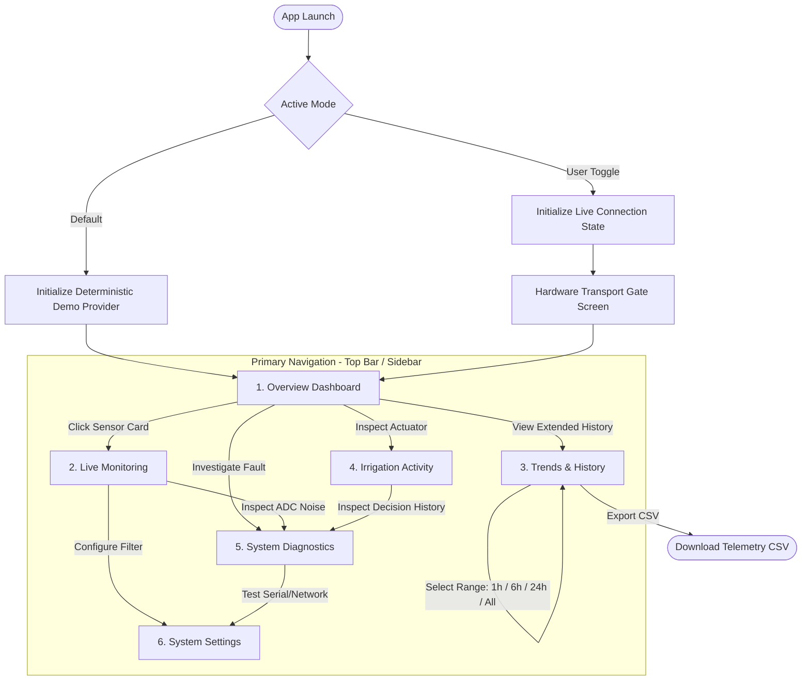

# Application Navigation Flow & User Journeys
## Smart Concrete Curing Monitoring System

**Document Version:** 1.0.0  
**Status:** Approved  

---

### 1. Navigation Architecture Diagram

---

### 2. Primary User Journeys

#### Journey 1: First Launch & Demo Mode Exploration
1. **Entry:** User opens the application URL in a standard browser.
2. **Initial State:** System initializes in `DEMO MODE` with a prominent warning bar indicating: `"DEMO MODE ACTIVE: Sensor readings are deterministically simulated. Not live hardware."`
3. **Overview Scan:** User views the 5 headline telemetry tiles:
   - Concrete Core Temp (DS18B20 #1): e.g. 34.2 °C [VALID]
   - Concrete Surface Temp (DS18B20 #2): e.g. 29.8 °C [VALID]
   - Ambient Temp / RH (DHT22): 31.3 °C / 88.2 % [VALID]
   - Moisture Sensor: Raw ADC: 2340 counts [UNCALIBRATED - Percentage unavailable]
   - Pump Relay State: IDLE [Last run: 42 min ago]
4. **Thermal Gradient Inspection:** User reads calculated $\Delta T = 4.4^\circ\text{C}$ with notice: `"Within safe thermal limit (< 20°C differential)"`.

#### Journey 2: Investigating a Missing Probe or Fault
1. **Scenario:** DS18B20 #2 bus connection is severed or unpopulated (reflecting observed bench condition `NA`).
2. **Visual Feedback:**
   - Tile changes from subtle neutral surface to a subdued slate/amber indicator with textual status: `UNAVAILABLE (1-Wire CRC Error / NA)`.
   - Numeric value is rendered as `—` (em-dash), not `0.0°C`.
   - The Thermal Gradient card automatically updates to: `"Gradient unavailable: Surface Probe disconnected"`.
3. **Troubleshooting Action:** User clicks `"View Diagnostics"` directly on the card to navigate to `System Diagnostics`.
4. **Diagnostic Verification:** System Diagnostics displays bus error counts, 1-Wire pin GPIO mapping, and physical debugging checklist (e.g., verifying 4.7kΩ pull-up resistor).

#### Journey 3: Inspecting Autonomous Irrigation Decisions
1. **Scenario:** User navigates to `Irrigation Activity` tab.
2. **Current State:** Pump is currently `IDLE`.
3. **Decision Audit Table:** User inspects chronologically ordered controller decisions:
   - `10:14:02 UTC`: *"Irrigation inhibited: Moisture percentage uncalibrated. Awaiting two-point baseline."*
   - `09:30:00 UTC`: *"Irrigation cycle completed: 180s timeout elapsed. Pump deactivated."*
   - `09:27:00 UTC`: *"Irrigation cycle triggered: Surface moisture dropped below threshold."*
4. **Safety Check:** User verifies that no remote manual "Pump ON" toggle exists, confirming adherence to DEC-005.

#### Journey 4: Switching to Live Mode (Protocol Gate)
1. **Action:** User toggles the mode switch in the header from `DEMO` to `LIVE`.
2. **State Transition:**
   - Synthetic data generation halts immediately.
   - History buffer clears demo points to prevent data pollution.
   - Header badge changes to high-contrast blue/amber: `"LIVE MODE: Disconnected (Awaiting Hardware Connection)"`.
3. **Protocol Gate Prompt:**
   - The UI presents the Milestone 4 Gate Status: informs operator that live communication is gated pending ESP32 firmware inspection.
   - Provides option to test local endpoint URL or review serial transport prerequisites.
   - Disallows silent fallback to demo values.

---

### 3. Edge Cases & Exception Handling

| Edge Case | User Experience & System Behavior |
|---|---|
| **Stale Telemetry (>15s without packet)** | Card values dim slightly, textual badge `STALE DATA` appears with last update timestamp relative time (e.g., "Updated 45s ago"). |
| **Out-of-Bounds ADC (< 100 or > 4095)** | Flagged as `INVALID (Floating Pin / Short Circuit)`. User alerted in Diagnostics. |
| **Malformed JSON Payload** | Rejected at validation layer; error counter incremented; application remains completely operational without crash. |
| **Mobile / Small Screen Viewport** | Navigation collapses to clean, single-line horizontal tab bar or drawer; cards stack in single column; chart switches to touch scrubber. |
