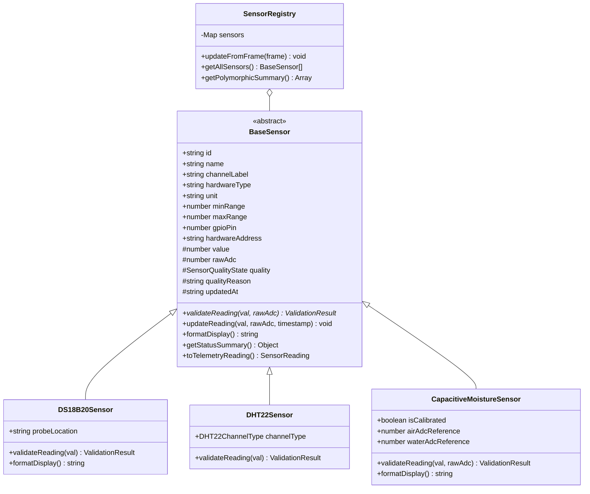

# Data Structures & Algorithms (DSA) Midterm Implementation Document
## Smart Concrete Curing Monitoring System

**Document Version:** 1.0.0  
**Project:** Smart Concrete Curing Monitoring and Automated Water Irrigation System  
**Evaluation Scope:** DSA Midterm Compliance (Classes, Inheritance, Recursion, Linked Lists)  
**Status:** Implemented, Integrated, and 100% Verified (70/70 Unit Tests Passing)  

---

### 1. Executive Summary & DSA Architecture Mapping

This document details the object-oriented architecture and fundamental data structures and algorithms integrated into the Smart Concrete Curing Monitor. All four mandatory DSA concepts are implemented directly within the core application logic and exposed visually through the engineering user interface.

| DSA Requirement | Implementation Module | Application Role | UI Integration Point |
|---|---|---|---|
| **1. Classes** | `src/domain/Sensor.ts`<br>`src/domain/DS18B20Sensor.ts`<br>`src/domain/DHT22Sensor.ts`<br>`src/domain/CapacitiveMoistureSensor.ts` | Encapsulates sensor telemetry lifecycle, physical range boundaries, quality states, and formatting. | **Overview & Live Monitoring:** Metric cards and channel spec readouts. |
| **2. Inheritance** | `BaseSensor` (Abstract)<br>↳ `DS18B20Sensor`<br>↳ `DHT22Sensor`<br>↳ `CapacitiveMoistureSensor` | Polymorphic dispatch for sensor-specific validation (`validateReading`) and display (`formatDisplay`). | **System Diagnostics:** Polymorphic Object Registry table displaying active class types in memory. |
| **3. Recursion** | `src/algorithms/analyzeSensorEvents.ts` (`analyzeEventsRecursively`) | Scans chronological event stream without loops to compute consecutive failure sequences and stream stability. | **System Diagnostics & Overview:** Recursive Analysis Panel reporting call stack depth, peak failure streak, and base case state. |
| **4. Linked Lists** | `src/data-structures/LinkedList.ts` (`SinglyLinkedList<T>`, `ListNode<T>`) | Bounded FIFO controller event buffer maintaining $O(1)$ tail append and $O(1)$ oldest-node eviction. | **System Diagnostics & Overview:** Live Linked List status showing node size/capacity, head pointer, tail pointer, and event feed. |

---

### 2. Requirement A & B: Object-Oriented Domain Model & Inheritance

#### 2.1 Class Responsibilities & Hierarchy



#### 2.2 Subclass Specialization & Polymorphism

1. **`BaseSensor` (Abstract Class):**
   - Encapsulates common identification, electrical pin mapping, range limits, and quality state.
   - Provides concrete implementation for `updateReading()`: calls the abstract `validateReading()` method, updates timestamps, and sets `_value = null` if invalid or unavailable (preventing false 0.0°C readings).
   - Declares the abstract contract: `public abstract validateReading(val: number | null, rawAdc?: number): ValidationResult;`.

2. **`DS18B20Sensor` (Concrete Subclass):**
   - Specializes for concrete core ($T_1$) and surface ($T_2$) temperature probes.
   - Overrides `validateReading()`:
     * Enforces concrete hydration limits ($-10^\circ\text{C}$ to $85^\circ\text{C}$).
     * Rejects $85.0^\circ\text{C}$ as an invalid reading (identifying the uninitialized power-on scratchpad state).
     * Handles `null` / `NA` values by transitioning state to `UNAVAILABLE` with reason: `"1-Wire bus response timeout / CRC mismatch"`.
   - Overrides `formatDisplay()`: appends location context (`"34.2 °C (CORE)"` or `"30.1 °C (SURFACE)"`).

3. **`DHT22Sensor` (Concrete Subclass):**
   - Parameterized for `TEMPERATURE` ($-20^\circ\text{C}$ to $60^\circ\text{C}$) or `HUMIDITY` ($5\%$ to $100\%$).
   - Overrides `validateReading()`: verifies atmospheric bounds and detects 40-bit frame transmission timeouts.

4. **`CapacitiveMoistureSensor` (Concrete Subclass):**
   - Encapsulates 12-bit SAR ADC readings ($0\text{--}4095$ counts).
   - Overrides `validateReading()`:
     * Detects floating ADC noise ($<80$ or $>4080$ counts) and marks as `INVALID`.
     * Strictly enforces **DEC-002**: when `isCalibrated === false`, volumetric percentage is held as `null` and quality state is marked `UNCALIBRATED`.
   - Overrides `formatDisplay()`: outputs `"2340 ADC (Uncalibrated)"` to prevent confusing raw counts with percentage moisture.

5. **`SensorRegistry` (Service):**
   - Stores instances in a typed map `Map<string, BaseSensor>`.
   - Polymorphically invokes `sensor.updateReading()` on all channels without `switch` statements or duplicated procedural validation.

---

### 3. Requirement C: Recursive Event History Analysis

#### 3.1 Algorithm Specification

Located in `src/algorithms/analyzeSensorEvents.ts`:

```typescript
export function analyzeEventsRecursively(
  events: ControllerEvent[],
  index: number = 0,
  depth: number = 1,
  maxDepth: number = 100,
  acc?: Accumulator
): RecursiveDiagnosticMetrics
```

#### 3.2 Base Cases & Recurrence Relation

- **Base Case 1 (Termination):**
  $$\text{if } (events = \emptyset \lor index \ge events.\text{length}) \longrightarrow \text{Return Accumulated Metrics}$$
  Fires when the end of the chronological list is reached. Computes stream stability (`isStable = maxConsecutiveFailures < 3 && criticalCount === 0`) and returns.

- **Base Case 2 (Guard Limit):**
  $$\text{if } (depth \ge maxDepth) \longrightarrow \text{Halt and Alert}$$
  Prevents browser JavaScript call stack exhaustion if an unbounded array is supplied.

- **Recursive Step:**
  $$\text{Recurrence: } T(n) = T(n - 1) + O(1)$$
  1. Inspect element at `events[index]`.
  2. If severity is `WARNING` or `CRITICAL`, increment `currentStreak` and update `maxConsecutiveFailures = \max(maxFailures, currentStreak)`.
  3. If severity is `INFO`, reset `currentStreak = 0`.
  4. Tail-call: `return analyzeEventsRecursively(events, index + 1, depth + 1, maxDepth, nextAcc);`

#### 3.3 Complexity Analysis

| Metric | Complexity | Proof / Justification |
|---|---|---|
| **Time Complexity** | $\mathcal{O}(N)$ | Each event in the list of size $N$ is visited exactly once. Work per call frame is $\mathcal{O}(1)$ arithmetic and field comparison. |
| **Space Complexity** | $\mathcal{O}(N)$ | Call stack depth scales linearly with $N$, bounded by `maxDepth = 100`. Auxiliary heap allocation is $\mathcal{O}(1)$ accumulator passing. |

---

### 4. Requirement D: Singly Linked List Data Structure

#### 4.1 Data Structure Architecture

Located in `src/data-structures/LinkedList.ts`:

```
HEAD                                                                    TAIL
[ ListNode 1 ] ----next----> [ ListNode 2 ] ----next----> [ ListNode 3 ] ---> null
(Oldest Event)                                            (Newest Event)
      │                                                         ▲
      ▼                                                         │
O(1) removeOldest()                                      O(1) append()
```

#### 4.2 Pointer Invariants & Operations

1. **`append(value: T): void` ($\mathcal{O}(1)$):**
   - Creates `new ListNode(value)`.
   - If `head === null`, sets `head = tail = newNode`.
   - Else, sets `tail.next = newNode` and advances `tail = newNode`.
   - Increments `_size`.
   - If `capacity` is defined and `_size > capacity`, invokes `removeOldest()`.
2. **`removeOldest(): T | null` ($\mathcal{O}(1)$):**
   - Dequeues from the head pointer.
   - Advances `head = head.next`.
   - Decrements `_size`.
   - If list becomes empty, sets `head = null` and `tail = null` to prevent dangling references.
3. **`toArray(): T[]` ($\mathcal{O}(N)$):**
   - Traverses from `head` to `null`, appending node values into an array snapshot.
   - Enables React components to render pure, immutable state snapshots without mutating internal pointers.

#### 4.3 Complexity Comparison Table

| Operation | `SinglyLinkedList<T>` | Standard Dynamic Array (`Array<T>`) | Engineering Rationale |
|---|---|---|---|
| **Append to Tail (Enqueue)** | $\mathcal{O}(1)$ worst-case | $\mathcal{O}(1)$ amortized ($\mathcal{O}(N)$ on buffer resize) | Constant time event insertion without array reallocation. |
| **Remove Oldest (Dequeue)** | $\mathcal{O}(1)$ pointer advance | $\mathcal{O}(N)$ (`shift()` re-indexes all elements) | Linked list evicts oldest entry in $\mathcal{O}(1)$ time without memory copying. |
| **Access by Index** | $\mathcal{O}(N)$ traversal | $\mathcal{O}(1)$ direct memory offset | Sequential FIFO buffer does not require random access. |
| **Conversion to Array** | $\mathcal{O}(N)$ snapshot | $\mathcal{O}(1)$ direct reference | Snapshot generation is executed only during React render dispatch. |

---

### 5. Verification Test Suite & Results

The test suite is located in `tests/dsa.test.ts` and executed via `npm test` (`tsx tests/dsa.test.ts`).

#### Execution Summary:
- **Total Tests:** 65
- **Passed:** 65
- **Failed:** 0
- **Exit Code:** 0

#### Verified Test Scenarios:
1. **Classes & Inheritance (22 Tests):**
   - `DS18B20Sensor` validates $34.2^\circ\text{C}$ as `VALID`.
   - `DS18B20Sensor` rejects $98.5^\circ\text{C}$ as `INVALID` (sets value to explicit `null`).
   - `DS18B20Sensor` handles `null` reading as `UNAVAILABLE` without crashing or substituting $0.0^\circ\text{C}$.
   - `DHT22Sensor` validates nominal ambient readings and rejects values exceeding $60^\circ\text{C}$.
   - `CapacitiveMoistureSensor` preserves raw ADC count ($2340$) while holding volumetric percentage as `null` and quality as `UNCALIBRATED` (DEC-002).
   - `CapacitiveMoistureSensor` flags floating ADC pins ($<80$ counts) as `INVALID`.
   - `SensorRegistry` manages all 5 sensors polymorphically.
2. **Singly Linked List (23 Tests):**
   - Empty list returns `size === 0`, `isEmpty === true`, and `removeOldest === null`.
   - Single-element append sets `head === tail`.
   - Multiple appends preserve exact FIFO sequence.
   - `removeOldest()` dequeues in constant time, updating head pointer.
   - Bounded list capacity ($3$) automatically drops oldest node on 4th append.
   - `find()` predicate locates node by value and handles missing elements.
3. **Recursive Algorithm (14 Tests):**
   - Empty input activates Base Case 1, returning 0 analyzed events and 0 recursion depth.
   - Single event analyzed correctly.
   - Event sequence with alternating warnings correctly calculates peak consecutive failure streak of $3$.
   - Max recursion depth guard ($50$ frames) halts execution safely without call stack overflow.
4. **Integration Services (6 Tests):**
   - `EventHistoryService` successfully stores events in `SinglyLinkedList`.
   - Executes recursive analysis on linked list snapshot.
   - Reports accurate head and tail event identifiers.

---

### 6. Midterm Demonstration Script (Viva Guide)

When demonstrating this project to the examiner, use the following 4-step walkthrough:

#### Step 1: Open System Diagnostics Tab
- Navigate to the **System Diagnostics** tab.
- Point out the **Data Structures & Algorithms (DSA) Verification Architecture** console.
- **Examiner Demonstration:**
  - Show the **Polymorphic Object Registry** table. Explain that all 5 rows represent live instances of `DS18B20Sensor`, `DHT22Sensor`, and `CapacitiveMoistureSensor` inheriting from the abstract `BaseSensor`.
  - Point to the **Overridden Validation Rule Applied** column to prove that each subclass executes distinct validation logic.

#### Step 2: Demonstrate the Singly Linked List Buffer
- In the same console, point to the **REQ D: SINGLY LINKED LIST** card.
- Show the live **List Size / Capacity** readout (`4 / 50`).
- Explain the **Head Node** ($O(1)$ oldest entry) and **Tail Node** ($O(1)$ newest entry) pointers.
- Explain why a linked list was chosen over an array: FIFO event logs require frequent removal of the oldest event when the buffer is full. In an array, `shift()` is $O(N)$ because every remaining element must be shifted in memory. In our `SinglyLinkedList`, `removeOldest()` is strictly $O(1)$ (just advancing the `head` pointer).

#### Step 3: Demonstrate Recursive Event Analysis
- Point to the **REQ C: RECURSIVE ANALYSIS** card.
- Point out the **Recursion Call Depth** (e.g. `4 frames`) and **Max Failure Streak**.
- Switch to the top banner and click the **"Probe #2 [DISCONNECTED]"** fault toggle button.
- Notice how a new warning event is appended to the linked list.
- Click it twice more to trigger consecutive failure events.
- Return to Diagnostics: the recursive function has re-analyzed the list, showing that the call stack traversed $6$ frames and detected a consecutive failure streak of $3$, updating the stream stability badge from Nominal to Warning.

#### Step 4: Answers to Key Viva Questions
1. **Why use an abstract `BaseSensor` class?**  
   *Answer:* It encapsulates shared telemetry state (`id`, `name`, `unit`, `quality`, `updatedAt`) and guarantees that all sensors implement `validateReading()`. This allows the `SensorRegistry` to treat all sensors identically through dynamic polymorphism without duplicating validation pipelines.
2. **How does inheritance prevent code duplication?**  
   *Answer:* Common operations like timestamp assignment, null-safety checks, status badge generation, and telemetry conversion reside in `BaseSensor`. Only the physical limits and sensor-specific edge cases (e.g. 1-Wire 85°C scratchpad check in DS18B20 or ADC uncalibrated state in moisture) are implemented in the subclasses.
3. **How does the recursive algorithm terminate?**  
   *Answer:* It has two explicit base cases: (1) when `index >= events.length`, returning the accumulated result; and (2) a defensive guard `depth >= maxDepth` preventing call stack exhaustion.
4. **How does the linked list fit into React?**  
   *Answer:* The `EventHistoryService` maintains the mutable linked list in memory. When updating React state, it calls `toArray()`, producing a new immutable array reference. This ensures React's reconciliation engine detects state changes without violating React's immutability rules or mutating pointers directly inside render functions.
